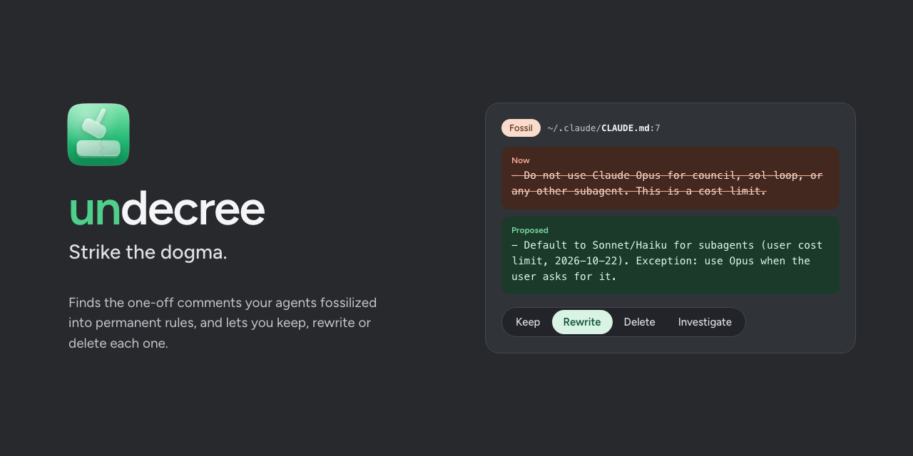
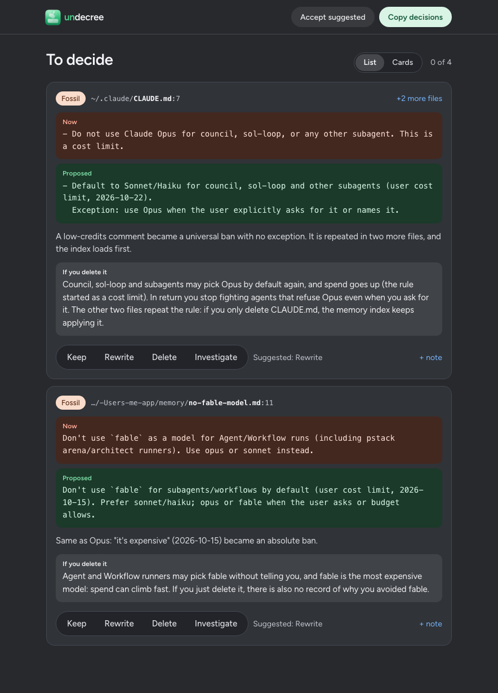
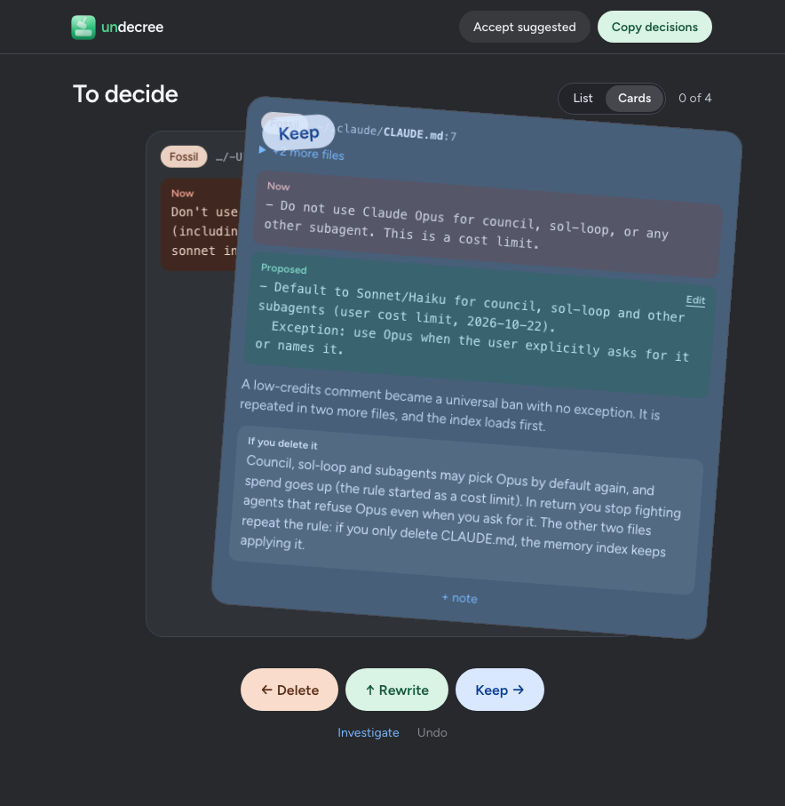

<p align="center">
  
</p>

<p align="center">One agent skill that finds the one-off comments your agents turned into permanent rules, and opens a review page where you keep, rewrite or delete each one.</p>

<p align="center">
  <a href="https://github.com/felipebasurto/undecree/actions/workflows/test.yml"></a>
  <a href="LICENSE"></a>
  <a href="https://agentskills.io"></a>
</p>

You said "I'm low on credits, don't use Opus" on a Tuesday. The agent saved it. Now it refuses to use Opus, even when you ask for it by name, and you don't remember why.

That is a **dogma**: an absolute directive that lost its context. A one-off comment ("just run this overnight", "answer short, I'm tired", "we no longer have access to X") written into `CLAUDE.md`, `AGENTS.md` or a memory file as a rule with no scope, no reason and no way out. Agents enforce it forever, and it is invisible until something stops working.

`undecree` reads your agent config, finds those rules, and shows them to you one at a time, with a proposed rewrite and what happens if you delete each one.

- **It reads every harness you have.** Claude Code, Codex, Cursor, Windsurf, Gemini CLI, Devin, OpenCode, plus project `CLAUDE.md` / `AGENTS.md` files. One scan, one list.
- **It ranks, then the agent judges.** A scanner scores every absolute line (bans, "always", "only", "from now on", limits like "under 20 words") and notes whether it has a scope, a reason, a date and an exception. The agent then opens the files and decides. The scanner is a candidate finder, not a verdict.
- **One card per rule, not per file.** The same rule restated in an index line, a memory description and `CLAUDE.md` is one decision, applied to all three.
- **You decide, it applies.** A review page with a **List** view and a **Cards** view you can swipe. Nothing is edited until you paste your decisions back.
- **It says what deleting would do.** Every card has an "If you delete it" line: what the agent will start doing again, and what it costs.

## Quick start

```bash
npx skills add felipebasurto/undecree -g
```

Then, in your agent:

```
/undecree
```

Codex uses `$undecree`, the Claude Code plugin uses `/undecree:undecree`. It also triggers on "why won't you use X", "clean my dogmas", "that rule no longer applies" and similar.

The agent scans, reads the top candidates, writes an `items.json`, and opens `review.html`. You mark each card, copy the decisions, and paste them back. It applies them and re-scans the files it touched.

## The review page

A single HTML file. No server, no network needed, state kept in the browser.

<p align="center">
  
  
</p>

Each card shows the rule **Now**, the **Proposed** rewrite (editable), one sentence on why it is a problem, and **If you delete it**. Choose **Keep**, **Rewrite**, **Delete** or **Investigate**, or press **Accept suggested** to take the agent's suggestion on every card.

The **Cards** view is one card at a time:

| Gesture | Action |
|---|---|
| Swipe or press **←** | Delete |
| Swipe or press **→** | Keep |
| Swipe or press **↑** | Rewrite with the proposed text (investigate, if the card has no proposal) |
| Swipe or press **↓** | Investigate |
| **z** | Undo |

You can drag with a mouse or a finger, flick, swipe with two fingers on a trackpad, use the arrow keys, or press the buttons. The card tilts and tints toward the action as you drag, and snaps back if you let go early. In the **List** view, `j`/`k` move and `1`–`4` choose.

Rules the agent read and found fine are listed at the bottom, collapsed, each with its path, the line as written and why it is fine, so you can see where everything came from.

## For agents

If a user sent you this repo and said "use this":

1. **Install the skill**, unless `undecree` is already in your skills folder: `npx skills add felipebasurto/undecree -g` (drop `-g` for the current project only).
2. **Run it.** Invoke `undecree`, or open [`skills/undecree/SKILL.md`](skills/undecree/SKILL.md) and follow it by hand: scan, triage, review, apply.
3. **Read global config whole.** The scanner misses phrasing it has never seen. `~/.claude/CLAUDE.md`, `AGENTS.md`, `GEMINI.md` and each `MEMORY.md` index are short: read them in full and run the scanner with `--unflagged`.
4. **Don't edit anything** until the user pastes their decisions. End your turn after opening the page.

## How it works

```
scan  ->  triage  ->  review page  ->  apply
```

**1. Scan.** [`find_dogmas.py`](skills/undecree/scripts/find_dogmas.py) walks the config of every harness it finds under `$HOME` and ranks the lines.

```text
$ python3 skills/undecree/scripts/find_dogmas.py --top 6
Harnesses found: claude-code, codex, cursor, devin, gemini, opencode, windsurf

== global config: 38 candidate lines, 33 distinct rules, best first ==
  !! [13] ~/.claude/CLAUDE.md:85  [date:Y reason:Y exc:- scope?:-] 120d old topic
        - **Update 2026-07-27:** the user no longer has GPT access. Do not plan GPT runs.
     [12] ~/.claude/CLAUDE.md:73  [date:- reason:- exc:- scope?:Y] cluster#1 topic
        - Use Haiku for all subagents while credits are low.
        + 1 more line(s) of the same rule/file: agent-test-budget.md:5
  !! [11] ~/.claude/projects/-Users-x-app/memory/no-opus.md:9  [date:- reason:- exc:- scope?:Y] cluster#2 topic
        Don't spawn Opus subagents or recommend Opus for delegated tasks.
        + 3 more line(s) of the same rule/file: CLAUDE.md:5, MEMORY.md:5, no-opus.md:5
  … 27 lower-ranked rules not shown (--top 0 lists all).
```

(That output is from the synthetic home directory the [evals](#evals) build, not from anyone's real config.)

| Mark | Means |
|---|---|
| `[13]` | Suspicion score. Rises for global config, model and cost words, no exception, short lines, old dates. Falls for descriptive text ("the server never restarts") and lasting reasons (security, policy, CI). |
| `!!` | An absolute with no exception in its own lines. |
| signals | `ban` (never, don't, avoid, prohibido), `absolute` (always, only, must, limits), `temporal` (the rule carries its origin: "for now", "I'm tired", "credits are low", "no longer"). |
| `cluster#N` | The same rule restated in several files. One decision. |
| `+ N more` | Other lines of the same rule, or of the same memory file, collapsed under the best-ranked one. |
| `memory:feedback` | The memory file's own `type`. `user` and `reference` memories are facts and rank lower. |
| `date` `reason` `exc` `scope` | What the line itself carries. Read from the line and its continuation lines, not the whole file. |

**2. Triage.** The agent opens the top candidates and reads around them. It writes `items.json`: one card per rule, a verdict, a suggested action, a proposed rewrite and the "if you delete it" outcome. Healthy rules go to a separate list and never get a card. See the [schema](skills/undecree/SKILL.md#itemsjson).

**3. Review.** [`make_review.py`](skills/undecree/scripts/make_review.py) turns `items.json` into the page above. You copy the decisions as JSON.

**4. Apply.** Per decision:

| Action | What the agent does |
|---|---|
| `keep` | Nothing. |
| `rescope` | Writes your (possibly edited) text to the file, and adapts it for each file where the rule is restated. |
| `delete` | Removes the line. For a memory file, also removes its `MEMORY.md` index line. |
| `review` | Investigates and reports back. Changes nothing yet. |
| `pending` | Skipped. Left alone. |

It then re-runs the scanner on the touched files to confirm the rule no longer reads as absolute.

### The health check

A directive should carry three things:

| Element | Looks like |
|---|---|
| Scope | "for subagents", "in this repo", "when X" |
| Reason and date | "(user cost limit, 2026-10-22)" |
| Exception or revisit | "unless the user asks", "revisit when Y" |

| Verdict | Meaning | Fix |
|---|---|---|
| **healthy** | All three. | No card. |
| **under-scoped** | A real rule that reads as absolute. | Add the exception. |
| **fossil** | A one-off generalized into a ban. | Rewrite with scope, or delete. |
| **stale** | Was scoped, but the world changed (lost access, switched tools). | Confirm with you. |

A rewrite looks like this:

```diff
-- Do not use Claude Opus for council, sol-loop, or any other subagent. This is a cost limit.
+- Default to Sonnet/Haiku for council, sol-loop and other subagents (user cost limit, 2026-10-22).
+  Exception: use Opus when the user explicitly asks for it or names it.
```

### Rules that don't fossilize

The skill also tells the agent how to avoid creating dogmas. Before saving anything to memory, `CLAUDE.md` or a rules file:

1. One-off? ("tonight", "I'm tired", "low on credits") Don't save it, or save it with an expiry.
2. Preference or fact? Save it with scope: "prefers X when Y".
3. Always record what, why, date, and when it stops applying.

## Supported harnesses

| Harness | Read |
|---|---|
| Claude Code | `~/.claude/CLAUDE.md`, `~/.claude/projects/*/memory`, `~/.claude/rules`, `~/.claude/agents` |
| Codex | `~/.codex/AGENTS.md`, `agents`, `prompts` |
| Cursor | `~/.cursor/rules` |
| Windsurf | `~/.codeium/windsurf/memories` |
| Gemini CLI | `~/.gemini/GEMINI.md` |
| Devin, OpenCode | `~/.config/devin`, `~/.config/opencode` (docs only) |
| Projects | `CLAUDE.md`, `AGENTS.md`, `GEMINI.md`, `.cursorrules`, `.windsurfrules`, `.clinerules`, `.cursor/rules`, `.claude/`, `.devin/`, `.codex/` under `$HOME` (depth 4) or any `--project PATH` |

Skill bodies (`SKILL.md`) are skipped by default: they are task guidance, not your rules. `--include-skills` adds them. To support a new harness, add its paths to the tables at the top of `find_dogmas.py`.

The scripts are stdlib-only Python 3 and read `Path.home()`. Nothing leaves your machine.

## Example

[`examples/demo/items.json`](examples/demo/items.json) is the `items.json` behind the screenshots above: four cards (a cost-limit ban on Opus repeated in three files, one on a pricier model, a stale "no Devin access", an under-scoped test budget) and three entries that were read and found fine.

```bash
python3 skills/undecree/scripts/make_review.py examples/demo/items.json -o review.html --open
```

## Evals

The scanner is regex and heuristics, so it has a test suite that says what it can and can't find. [`evals/`](skills/undecree/evals) builds a fake `$HOME` with labelled lines (dates are relative to today, so it never goes stale), runs the real scanner on it, and measures:

- **Lexical recall**: did it flag the lines that are dogmas.
- **Global coverage**: flagged lines plus the `--unflagged` safety net, for the global files an agent reads whole.
- **Ranking**: do real candidates score above healthy rules and above ordinary text (AUC).
- **False positives** on descriptive text ("the server never restarts"), exclusion leaks (code fences, comments, skills, `node_modules`), cluster and line-level flag checks.
- **The review page** with hostile input: `</script>` and template placeholders inside rule text, duplicate ids, unknown values, healthy items, language selection, and (when Node is installed) a syntax check of the page's JavaScript.

```bash
python3 skills/undecree/evals/run_evals.py [-v] [--suite scanner|holdout|holdout2|holdout3|holdout4|holdout5|holdout6|page] [--gate-holdout]
```

CI runs it on Python 3.10 and 3.13 (the scripts also run on 3.9, which is what macOS ships). The main corpus gates; so do the held-out rounds, once folded in.

**What the numbers mean.** The held-out rounds are the honest part. Each one was written fresh, run against the scanner as it was, and only then were the misses folded into the patterns. A round you tuned against measures nothing about new phrasing, so the suite keeps getting new rounds. First runs, before any change:

| Round | Lexical recall | False positives | What it probed |
|---|---|---|---|
| 3 | ~65–70% | 46.7% | descriptive text |
| 4 | ~65–70% | 8.3% | mixed phrasing |
| 5 | 75.9% | 75.0% | project files, memory types, `Why:` lines, preambles |
| 6 | 71.4% | 14.3% | dogmas phrased as statements |

After folding in, every round scores 100% recall (0–13% false positives), but expect the next fresh round to land near 70% again. The skill is built around that limit:

- Global config is never judged from pattern hits alone. The agent reads it whole, and `--unflagged` lists every line no pattern matched ("Speak like a pirate."), plus the lines hidden as plain facts. Global coverage is 100% on every round because of it.
- Lines that read as facts about a system ("The cron never runs on weekends.", "Only two engineers have prod access.") are kept out of the ranked list unless they carry a prohibition or a risky topic (models, cost, credits). That cut false positives, and it is the riskiest heuristic: round 6 was written to attack it.
- Project rule files have no unflagged safety net (only tier-1 bans and risky topics are shown there). Project recall on unseen phrasing was ~50% in early rounds, then 88% in round 5 and 100% in round 6.
- Memory files carry a `type`. `user` and `reference` memories are facts and rank lower; `feedback` ranks higher.

When you change the scanner, run the evals before and after, and write a new round before trusting the numbers.

## Install

With the [skills CLI](https://github.com/vercel-labs/skills), for Claude Code, Cursor, Codex, Gemini CLI, OpenCode and other agents:

```bash
npx skills add felipebasurto/undecree -g
```

As a Claude Code plugin:

```bash
claude plugin marketplace add felipebasurto/undecree
claude plugin install undecree@undecree
```

As a Gemini CLI extension:

```bash
gemini extensions install https://github.com/felipebasurto/undecree
```

By hand:

```bash
git clone https://github.com/felipebasurto/undecree
cp -R undecree/skills/undecree ~/.claude/skills/   # or ~/.cursor/skills/, ~/.codex/skills/
```

| Agent | Invoke with |
|---|---|
| Claude Code | `/undecree` (plugin: `/undecree:undecree`) |
| Cursor | `/undecree` |
| Codex | `$undecree` |
| Gemini CLI | "use the undecree skill" |
| Any other agent | "Follow `skills/undecree/SKILL.md` on my agent config" |

## Repo layout

```
skills/undecree/
  SKILL.md              the skill: workflow, items.json schema, apply rules
  scripts/
    find_dogmas.py      scanner: ranks candidate lines across every harness
    make_review.py      items.json -> self-contained review.html
  evals/
    corpus.py           labelled fake $HOME, one function per round
    run_evals.py        metrics and gates
  assets/               mark, flat mark, brand notes
examples/demo/          the items.json behind the screenshots
```

The mark is a gavel cracking a stone tablet, in green on purpose. Brand notes (palette, type, voice) are in [`BRAND.md`](skills/undecree/assets/BRAND.md).

## Pairs well with

[testectomy](https://github.com/felipebasurto/testectomy) does the same kind of pass for tests: it cuts a suite down to the tests that matter. [unslop-ui](https://github.com/felipebasurto/unslop-ui) does it for interface copy and charts.

## License

[MIT](LICENSE)
